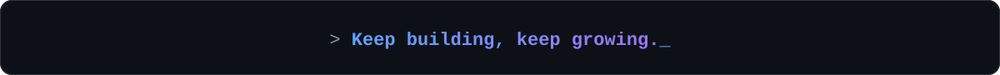

  

<h1 align="center">Hi, I'm Sandhya R. 👋</h1>

  <b>Aspiring Software Developer | Backend &amp; Full-Stack Development</b>

  I'm a software developer interested in building practical applications, developing reliable backend APIs,
  and creating user-friendly full-stack solutions. I enjoy problem-solving, exploring technologies,
  and improving my development skills through real-world projects.

  
  

---

## 🧑‍💻 About Me

- 🔧 Interested in **backend and full-stack development**
- 🌐 Building **REST APIs** and practical software applications
- 🗄️ Working with **databases** and application logic: schemas, migrations, authentication
- 🧩 Continuously improving my **programming and problem-solving** skills
- 🎨 Exploring **frontend technologies** to build complete, end-to-end applications

---

## 🛠️ Tech Stack

<table>
  <tr>
    <td width="170"><b>Languages</b></td>
    <td> </td>
  </tr>
  <tr>
    <td><b>Backend</b></td>
    <td></td>
  </tr>
  <tr>
    <td><b>Frontend</b></td>
    <td></td>
  </tr>
  <tr>
    <td><b>Databases</b></td>
    <td></td>
  </tr>
  <tr>
    <td><b>AI &amp; LLMs</b></td>
    <td>
      
      
      
      
      
      
    </td>
  </tr>
  <tr>
    <td><b>Tools</b></td>
    <td></td>
  </tr>
</table>

---

## 🚀 Featured Projects

<table>
  <tr>
    <td>
      <h3>🏥 MediConnect</h3>
      

        A hospital appointment booking platform. Patients find doctors and nearby hospitals, book slots and get reminders,
        with an AI assistant that helps search and suggests bookings — but never books on its own.
      

      <ul>
        <li>Django REST API + Next.js frontend, fully Dockerized with PostgreSQL/PostGIS, Redis and Elasticsearch</li>
        <li>Fuzzy doctor search with synonyms and autocomplete; nearby-hospital map using PostGIS and OpenStreetMap</li>
        <li>Celery jobs for email reminders, live notifications over WebSockets (Django Channels)</li>
        <li>OpenAI assistant with tool calling and safety rules; Playwright scraper for hospital websites</li>
        <li>Tested with pytest and Playwright end-to-end tests</li>
      </ul>
      

        
      

      

        <a href="https://github.com/Sandhya192005/MediConnect"><b>📂 Repository</b></a> &nbsp;·&nbsp; <i>Demo: not deployed yet</i>
      

    </td>
  </tr>
  <tr>
    <td>
      <h3>🥗 AI Food Agent</h3>
      

        A personal nutrition assistant. Upload a photo of a meal and AI vision estimates its calories, protein and fat.
        Recommendations are personalized to your profile, diet preference, health conditions and budget.
      

      <ul>
        <li>JWT authentication with automatic BMI / BMR / daily-calorie and water-goal calculation</li>
        <li>REST API for meal, water-intake and office-menu logging</li>
        <li>PostgreSQL / SQLite via SQLAlchemy + Alembic, tested with pytest, Dockerized</li>
      </ul>
      

        
      

      

        <a href="https://github.com/Sandhya192005/Food-Agent"><b>📂 Repository</b></a> &nbsp;·&nbsp; <i>Demo: not deployed yet</i>
      

    </td>
  </tr>
  <tr>
    <td>
      <h3>💚 AI Health Agent <i>(team project)</i></h3>
      

        An employee wellbeing system with three parts: a background desktop agent, a FastAPI server, and a React dashboard
        that shows AI-written wellbeing reminders.
      

      <ul>
        <li>Offline-first desktop agent that buffers activity locally and syncs without losing or duplicating events</li>
        <li>LLM-generated break / idle / distraction reminders, spoken aloud by an on-screen assistant</li>
        <li>Role-based dashboard: admins see the organization, employees see only their own day</li>
      </ul>
      

        
      

      

        <a href="https://github.com/Suba-kumar09/health-agent"><b>📂 Repository</b></a> &nbsp;·&nbsp; <i>Demo: not deployed yet</i>
      

    </td>
  </tr>
</table>

---

## 🗂️ Other Projects

| Project | Description | Tech |
|---|---|---|
| [🏠 Home Layout](https://github.com/Sandhya192005/home-layout) | Generates dimensioned 2D/3D floor plans from plot size, rooms, budget and Vastu, with cost estimates | FastAPI · PostgreSQL · React · Three.js |
| [📄 RAG-LangChain](https://github.com/Sandhya192005/RAG-LangChain) | "Chat with my resume" — a RAG pipeline built step by step: load, chunk, embed, retrieve, generate | Python · LangChain · OpenAI · pgvector |
| [📦 Cargo Email Automation](https://github.com/Sandhya192005/Cargo-Email-Automation) | Reads shipment emails from Outlook, uses AI to classify them and extract details, logs them to Excel and sends customer reports after human approval | n8n · Claude AI · Outlook · Excel |
| [📚 Book Swapper](https://github.com/Sandhya192005/book-swapper) | List, discover and exchange books (sell, swap, borrow or donate) with requests, ratings and location info | React · TypeScript · Tailwind |
| [💰 Budget Tracker](https://github.com/Sandhya192005/budget-tracker) | Personal finance dashboard with transactions, budgets and spending charts | React · TypeScript · Tailwind |
| [🤖 Local LLM Chat](https://github.com/Sandhya192005/HuggingFace) | Terminal chatbot running Qwen2.5-3B fully on CPU — no GPU or API key | Python · llama.cpp · Hugging Face |
| [⭐ Product Review System](https://github.com/Sandhya192005/product-review-system) | Login-gated app to add products with star ratings and reviews, with live search | HTML · CSS · JavaScript |
| [🩸 Donor List Management](https://github.com/Sandhya192005/donor-list-management) | Searchable donor list with sign-up/login and add, edit and delete records | HTML · CSS · JavaScript |
| [🎓 CGPA Calculator](https://github.com/Sandhya192005/CGPA-calculator) | Calculates semester GPA and overall credit-weighted CGPA for an 8-semester curriculum | HTML · CSS · JavaScript |

---

## 💼 Experience &amp; Practical Work

### Full Stack Developer Intern | Finstein Advizory
- Worked on health and food-related application projects.
- Gained hands-on experience with **Python, FastAPI, and PostgreSQL**.
- Explored REST API development and database integration.
- Gained exposure to **Databricks** and data-related workflows.

### MERN Stack Developer Intern | Altruisty
- Gained practical experience in web application development.
- Worked with the **MERN stack**.
- Explored frontend and backend integration in web applications.

---

## 🎯 What I'm Focusing On

| | |
|---|---|
| 🔌 | Backend engineering and REST APIs |
| 🏗️ | Database integration and application architecture |
| ⚛️ | React and TypeScript for frontend development |
| ✨ | Writing clean, maintainable code |
| 🧠 | Improving problem-solving and software development skills |

---

## 📊 GitHub Activity

  
  

---

## 📫 Connect With Me

  
  
  

---

  

