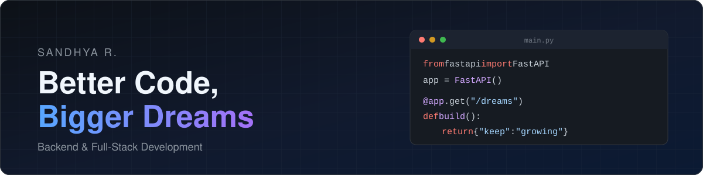

  

<h1 align="center">Hi, I'm Sandhya R. 👋</h1>

  <b>Aspiring Software Developer | Backend &amp; Full-Stack Development</b>

  I'm a software developer interested in building practical applications, developing reliable backend APIs,
  and creating user-friendly full-stack solutions. I enjoy problem-solving, exploring technologies,
  and improving my development skills through real-world projects.

  
  

---

## 🧑‍💻 About Me

- 🔧 Interested in **backend and full-stack development**
- 🌐 Building **REST APIs** and practical software applications
- 🗄️ Working with **databases** and application logic: schemas, migrations, authentication
- 🧩 Continuously improving my **programming and problem-solving** skills
- 🎨 Exploring **frontend technologies** to build complete, end-to-end applications

---

## 🛠️ Tech Stack

<table>
  <tr>
    <td width="170"><b>Languages</b></td>
    <td></td>
  </tr>
  <tr>
    <td><b>Backend</b></td>
    <td></td>
  </tr>
  <tr>
    <td><b>Frontend</b></td>
    <td></td>
  </tr>
  <tr>
    <td><b>Databases</b></td>
    <td></td>
  </tr>
  <tr>
    <td><b>Tools</b></td>
    <td></td>
  </tr>
</table>

---

## 🚀 Featured Projects

<table>
  <tr>
    <td>
      <h3>🏠 Home Layout</h3>
      

        Turns home-building requirements (plot size, facing, rooms, parking, floors, budget and Vastu preference) into a
        fully dimensioned floor plan. There are no templates: every plan is generated from the input.
      

      <ul>
        <li>2D SVG viewer and a Three.js 3D walkthrough built from the same plan data</li>
        <li>Manual layout editor with undo/redo, cost estimate, bill of quantities and PNG/PDF export</li>
        <li>JWT auth with rotating refresh tokens, versioned plan history and shareable read-only links</li>
        <li>PostgreSQL with SQLAlchemy + Alembic migrations, covered by a pytest suite</li>
      </ul>
      

        
      

      

        <a href="https://github.com/Sandhya192005/home-layout"><b>📂 Repository</b></a> &nbsp;·&nbsp; <i>Demo: not deployed yet</i>
      

    </td>
  </tr>
  <tr>
    <td>
      <h3>🥗 AI Food Agent</h3>
      

        A personal nutrition assistant. Upload a photo of a meal and AI vision estimates its calories, protein and fat.
        Recommendations are personalized to your profile, diet preference, health conditions and budget.
      

      <ul>
        <li>JWT authentication with automatic BMI / BMR / daily-calorie and water-goal calculation</li>
        <li>REST API for meal, water-intake and office-menu logging</li>
        <li>PostgreSQL / SQLite via SQLAlchemy + Alembic, tested with pytest, Dockerized</li>
      </ul>
      

        
      

      

        <a href="https://github.com/Sandhya192005/Food-Agent"><b>📂 Repository</b></a> &nbsp;·&nbsp; <i>Demo: not deployed yet</i>
      

    </td>
  </tr>
  <tr>
    <td>
      <h3>💚 AI Health Agent <i>(team project)</i></h3>
      

        An employee wellbeing system with three parts: a background desktop agent, a FastAPI server, and a React dashboard
        that shows AI-written wellbeing reminders.
      

      <ul>
        <li>Offline-first desktop agent that buffers activity locally and syncs without losing or duplicating events</li>
        <li>LLM-generated break / idle / distraction reminders, spoken aloud by an on-screen assistant</li>
        <li>Role-based dashboard: admins see the organization, employees see only their own day</li>
      </ul>
      

        
      

      

        <a href="https://github.com/Suba-kumar09/health-agent"><b>📂 Repository</b></a> &nbsp;·&nbsp; <i>Demo: not deployed yet</i>
      

    </td>
  </tr>
</table>

---

## 💼 Experience &amp; Practical Work

- **Backend development with Python &amp; FastAPI:** built layered REST APIs (routers → services → repositories) with request validation and JWT authentication
- **PostgreSQL database integration:** designed schemas with SQLAlchemy 2.0 and managed changes through Alembic migrations
- **REST API development:** auth, CRUD and domain endpoints, documented and tested through Swagger / OpenAPI and pytest
- **Team collaboration:** contributed to a team project (Health Agent) using Git feature branches and pull-request workflows on GitHub
- **Exploring data tools:** learning SQL, PySpark and Databricks alongside application development

---

## 🎯 What I'm Focusing On

| | |
|---|---|
| 🔌 | Backend engineering and REST APIs |
| 🏗️ | Database integration and application architecture |
| ⚛️ | React and TypeScript for frontend development |
| ✨ | Writing clean, maintainable code |
| 🧠 | Improving problem-solving and software development skills |

---

## 📊 GitHub Activity

  
  

---

## 📫 Connect With Me

  
  
  <!-- TODO: replace with mailto:your@email.com -->
  

---

  

